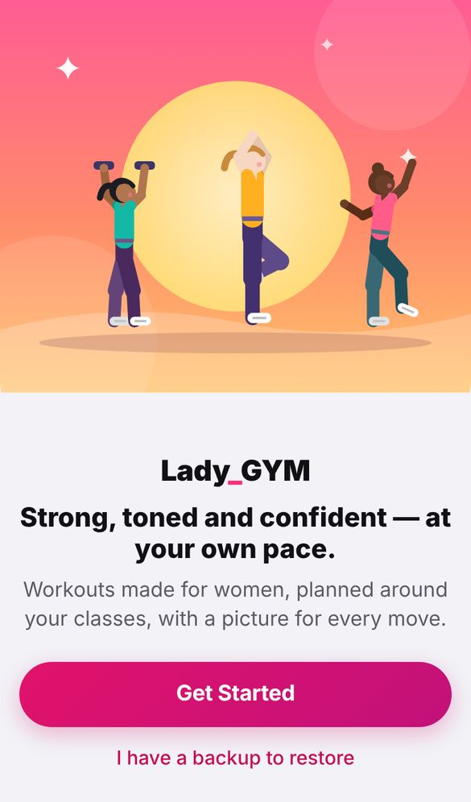
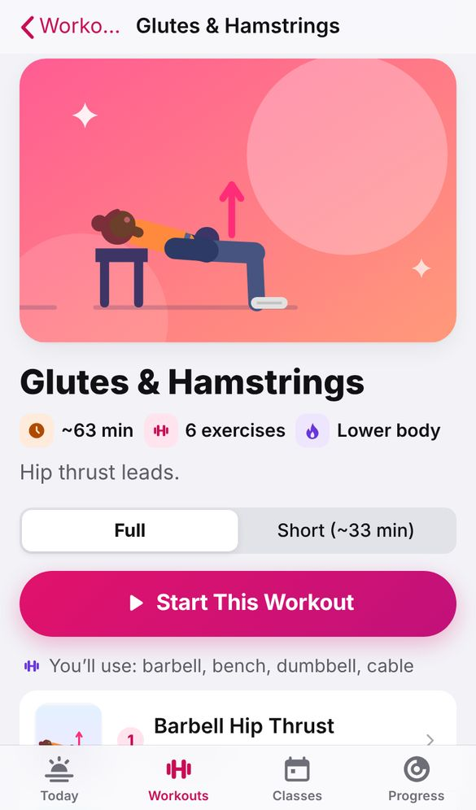
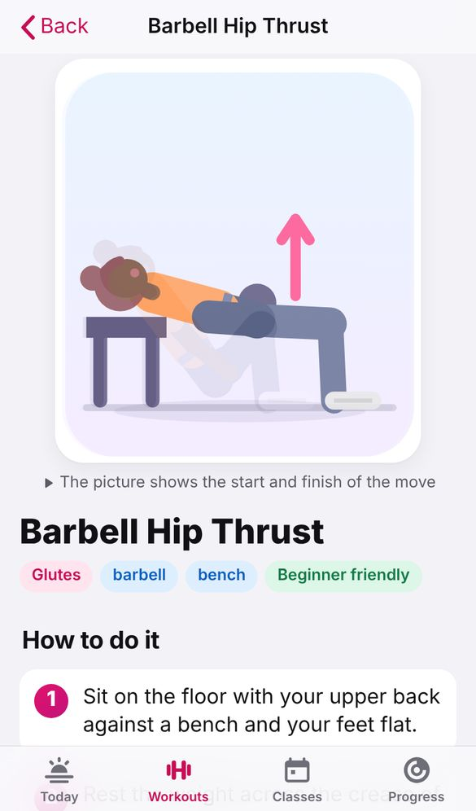
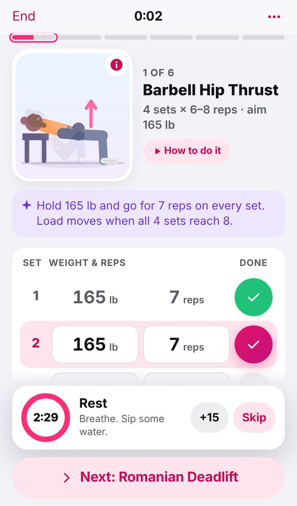
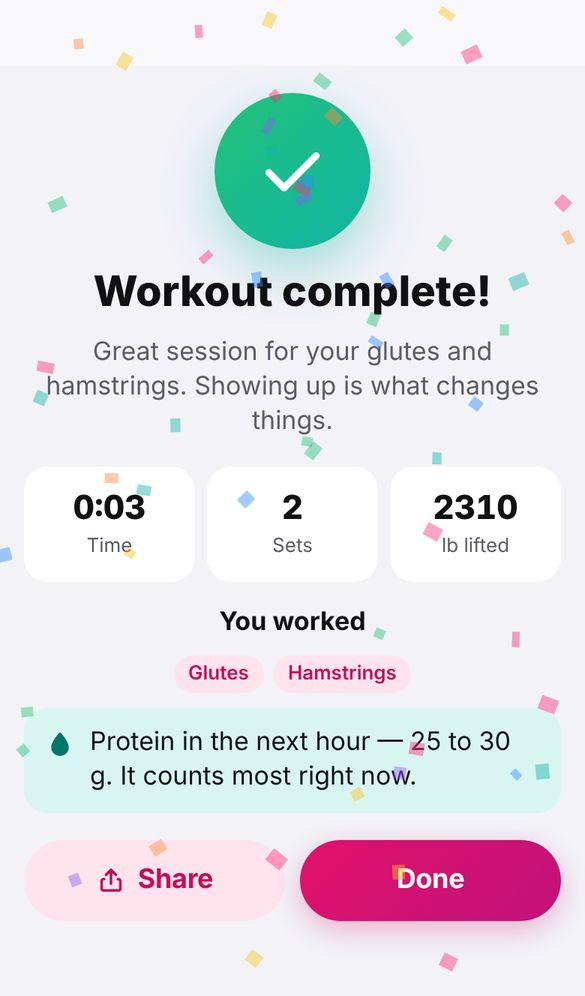
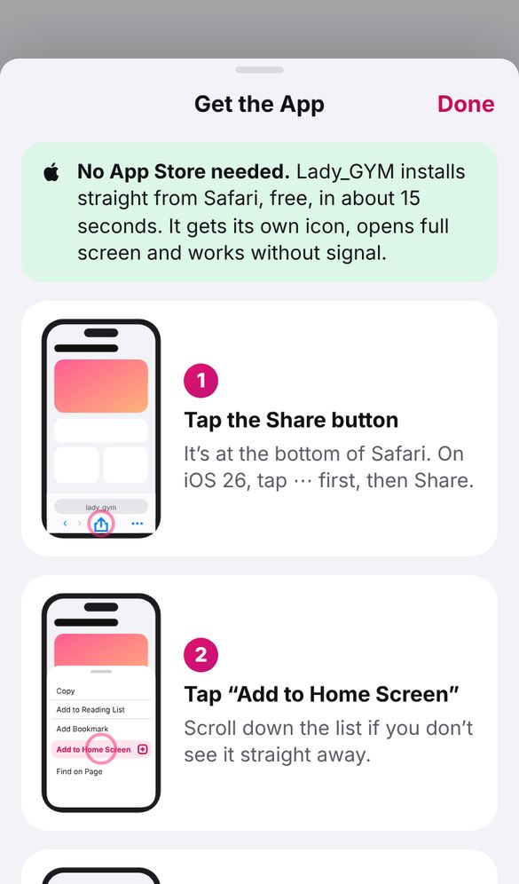

# Lady_GYM — v1.0.0

**Workouts made for women, planned around your club classes, with a picture for every move.**

This is Daybreak's successor ("daybreak2"). It was rebuilt after every woman Daybreak was sent
to declined to use it. [docs/REVIEW_OF_DAYBREAK.md](docs/REVIEW_OF_DAYBREAK.md) covers what
they said, what they meant, and what changed, with measurements and before/after screenshots.

**To send to people:** https://sal-padilla.github.io/daybreak/ladygym. The ready-to-send
invite text is in [docs/INVITE.md](docs/INVITE.md).
**The app itself:** https://sal-padilla.github.io/daybreak/Lady_GYM/
*(Both go live once this is merged into `main` and GitHub Pages has published.)*

| | | |
|---|---|---|
|  |  |  |
|  |  |  |

---

## What it does

**Today:** a picture of today's workout and one big **Start Workout** button. Below it, a
three-tap check-in ("How did you sleep?", using faces) that lightens the weights on a rough
morning, your week as coloured day circles, four rings for the week's balance, your next
classes and a protein check.

**Workouts:** your plan as picture tiles, a ~30-minute short version, build-your-own, and an
exercise library by body area. Each of the 144 exercises has an illustrated woman, step-by-step
instructions, a breathing cue, tips, a video link and your own progress chart.

**The workout itself** opens full screen. An optional guided warm-up, then one exercise at a
time with a moving picture. Weights and reps come pre-filled from last time: tap the big round
tick to log a set, and the rest timer starts. Changing a number opens a keypad with large keys.
Every set is saved the moment it's ticked. At the end: confetti, your time, sets and pounds
lifted, and a trophy for any personal best.

**Classes:** the real Bay Club Redondo Beach morning timetable as illustrated cards. Pick a
day, tap **+**, choose "every week" or "just this once", and your lifting is re-planned around
it. Hard leg classes are kept away from leg day automatically, as in Daybreak.

**Progress:** a week streak, four rings (Strength, Cardio, Balance & Core, Tone & Shape), a
colour body map of where you trained, progress photos with a then-and-now comparison, waist and
hip tracking (the measurements that show change the scale hides), InBody scan entry, "Getting
stronger" trophies, and a weekly report to share.

**Profile** (tap your photo, top right): name, photo, goal, experience, life stage, the private
pelvic-floor question, rest timer, appearance, Add to Home Screen, invite a friend, backup and
restore. Daybreak backups restore here too.

## Put it on an iPhone

Send people the **get page** above. It draws the steps for whichever browser they're in, and
says plainly that there's nothing to download from the App Store. The short version:
**Safari → Share → Add to Home Screen → Add.** For a real App Store or TestFlight app, see
[docs/APP_STORE.md](docs/APP_STORE.md). The Xcode project is ready in `native/`.

## Run it locally

From the repository root:

```bash
node dev-server.mjs
```

Then open **http://localhost:8123/Lady_GYM/**.

## Checks

```bash
node Lady_GYM/tools/check.mjs
```

The checks cover: WCAG AA contrast for every text colour in both themes, and for white text on
every hero, tile and button; every code file precached for offline use; the service-worker
cache matching the app version; all 144 exercises and 18 class formats illustrated; and a full
week building for every life stage × experience combination.

After changing the icon artwork:

```bash
node Lady_GYM/tools/make-icons.mjs
```

## How it's built

Vanilla JS, ES modules, no build step, no dependencies, no accounts and no server. Everything
stays on the phone, in its own database (`LadyGymDB`), separate from Daybreak's.

```
index.html  get.html  manifest.json  sw.js
css/      tokens (colour, type, shape) · app (iOS kit) · screens
js/
  core/     nav (tabs, push/pop, swipe-back, full-screen modals) · db · store
  art/      figure (redraws every exercise as an illustrated woman) · scenes (classes, heroes)
  ui/       kit (sheets, alerts, keypad, haptics, confetti) · icons · rings · timer
  features/ onboarding · today · workouts · player · classes · progress · profile · install
  engine/   lifestage · progression · scheduler · sessionplan · readiness · recommend · shapemap · report
  data/     exercises (144) · classes (real timetable) · programs · pillars · info · warmup · inbody
native/   Capacitor 8 wrapper + Xcode project for TestFlight / App Store
tools/    check.mjs · make-icons.mjs
docs/     REVIEW_OF_DAYBREAK.md · APP_STORE.md · screens/
```

**Reused from Daybreak without changes:** the whole training engine (`engine/`, `data/`,
`core/db` and `core/store`). The research behind it is in the root
[PROJECT_PLAN.md](../PROJECT_PLAN.md). **New:** everything she sees.

Lady_GYM gives general fitness guidance. It is not medical advice.
